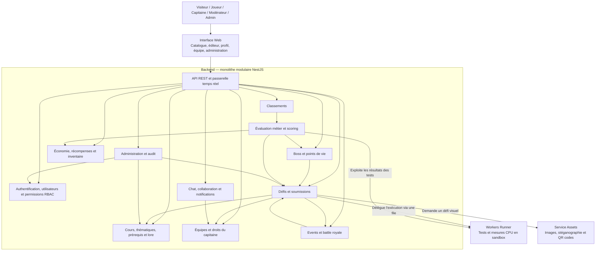
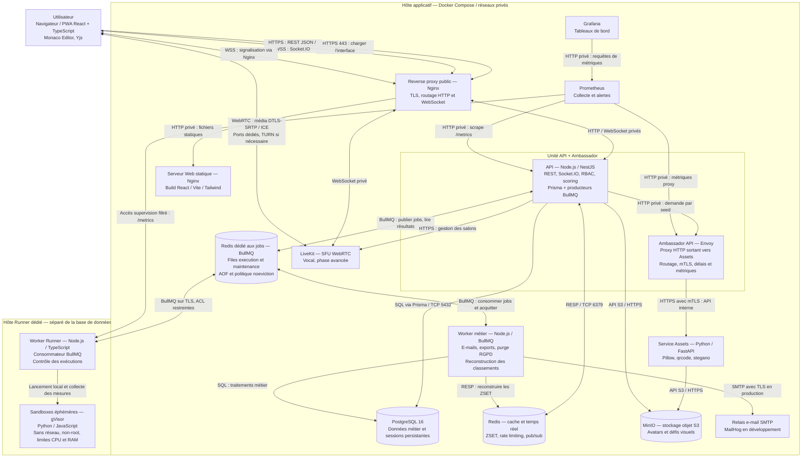
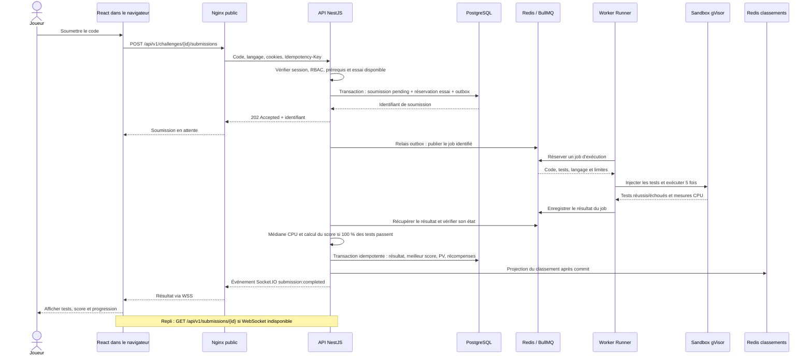

# CodeQuest — Schémas fonctionnel et d’infrastructure

## 1. Périmètre et choix d’architecture

Ce document décrit une **architecture cible**, et non une infrastructure déjà implémentée. Il s’appuie sur la *Spécification fonctionnelle et technique — Plateforme de défis informatiques*, version 1.0 du 23 octobre 2026, notamment les sections 5, 8, 11 et 14. Les maquettes existantes sont des écrans statiques sans backend.

L’architecture conserve le **monolithe modulaire NestJS** prévu dans le PDF. L’exécution du code et la génération des défis visuels sont séparées. Les tâches longues sont déléguées à des workers pour ne pas bloquer les requêtes utilisateur.

**Ajouts proposés pour concrétiser le schéma :** Nginx comme reverse proxy, Envoy pour le patron Ambassador, BullMQ pour les jobs Node.js, FastAPI pour le service Assets et Prisma pour l’accès aux données. Ces technologies précisent des alternatives ou des détails laissés ouverts par le PDF ; elles ne sont pas des composants déjà présents.

Deux représentations se complètent :
- le schéma fonctionnel montre les dépendances entre responsabilités métier ;
- le schéma d’infrastructure montre les processus, leur hébergement et leurs communications.

## 2. Schéma fonctionnel — dépendances entre composantes

Une flèche `A → B` signifie que **A utilise B**. Les blocs regroupés dans le backend sont des modules du même logiciel, pas des microservices.

**Règles transversales :** les opérations protégées passent par l’authentification et les permissions RBAC. L’API vérifie les prérequis, les droits d’équipe et les limites d’essais avant d’accepter une soumission. Le runner mesure et teste ; **le backend reste responsable du score et des récompenses**.

Les cours et le lore alimentent la progression. Les résultats validés alimentent les classements, l’expérience, les récompenses et, selon le défi, les PV du boss ou du joueur. Le chat et la collaboration vérifient les droits d’accès aux canaux et aux équipes.

## 3. Schéma d’infrastructure

Les flèches portent le protocole ou le mécanisme d’échange. Une liaison bidirectionnelle représente un échange dans les deux sens ; elle n’implique pas que les deux composants peuvent initier librement une connexion.

**Point important :** l’interface React s’exécute dans le navigateur. Le serveur Web fournit ses fichiers ; ce sont ensuite les appels du navigateur qui rejoignent l’API par le reverse proxy. Le trafic ne traverse donc pas le serveur de fichiers statiques pour chaque requête API.

Le schéma représente la cible complète : Assets, collaboration, battle royale et vocal peuvent être ajoutés aux phases prévues par le PDF. Le MVP repose principalement sur Web, API, PostgreSQL, Redis, file de jobs et runners.

### 3.1 Rôle exact du patron Ambassador

Un **Ambassador est un proxy auxiliaire associé à un service pour prendre en charge certaines de ses communications sortantes**. Ici, l’API appelle une adresse interne stable exposée par Envoy ; Envoy contacte le service Assets et prend en charge les certificats clients mTLS, le routage, les délais d’attente et les métriques réseau. FastAPI doit être servi derrière une terminaison TLS capable de vérifier les certificats clients, par exemple son frontal Nginx.

L’API et Envoy sont deux conteneurs distincts, déployés et configurés ensemble. L’adresse d’écoute d’Envoy reste sur un réseau Docker privé ; elle n’est pas publiée sur Internet. Sous Compose, l’API le joint par son nom DNS interne, **pas par `localhost`**, sauf partage explicite de l’espace réseau. Sous Kubernetes, ils pourront être placés dans le même Pod, Envoy devenant alors un sidecar.

| Composant | Rôle | Ce qu’il ne fait pas |
|---|---|---|
| Nginx public | Reçoit les connexions entrantes et route vers Web, API et signalisation LiveKit | Ne remplace pas l’Ambassador sortant |
| Envoy Ambassador | Représente l’API auprès du service Assets pour les communications HTTP sortantes | Ne calcule aucun score et n’exécute aucun job |
| Redis + BullMQ | Met les travaux en attente et coordonne leur traitement asynchrone | N’est ni un proxy ni une sandbox |
| Worker Runner | Consomme les jobs et pilote des sandboxes locales | Ne donne pas d’accès réseau au code soumis |

L’Ambassador ne doit pas être confondu avec le produit *Ambassador Edge Stack*. Tous les échanges ne passent pas par Envoy : PostgreSQL, Redis et MinIO conservent leurs clients spécialisés. Ajouter un proxy à chaque liaison sans besoin identifié augmenterait inutilement la complexité.

Les relances HTTP ne sont autorisées que pour des opérations idempotentes. La génération d’un asset utilise un identifiant de demande stable et une seed, afin d’éviter les doublons en cas de nouvelle tentative.

### 3.2 Technologies par brique

| Brique | Technologies retenues ou proposées | Responsabilité |
|---|---|---|
| Client Web / PWA | React, TypeScript, Vite, Tailwind, Monaco | Interface responsive et éditeur de code |
| Reverse proxy / Web statique | Nginx | HTTPS, fichiers statiques, routage REST et WebSocket |
| API | Node.js, NestJS, Prisma, OpenAPI 3 | Authentification, règles métier, transactions et administration |
| Temps réel | Socket.IO ; Yjs avec transport adapté aux mises à jour CRDT | Résultats, chat et collaboration ; Yjs n’est pas à lui seul un transport réseau |
| Ambassador | Envoy | Proxy sortant HTTP API → Assets, mTLS et contrôle des communications |
| Base métier | PostgreSQL 16 | Source de vérité : comptes, soumissions, scores, économie, audit |
| Cache / diffusion | Redis | Cache de sessions et révocations, classements ZSET, rate limiting et pub/sub |
| File de travaux | BullMQ sur une instance Redis distincte | Jobs d’exécution et de maintenance, suivi des états et relances |
| Worker Runner | Node.js / TypeScript, BullMQ | Orchestration de l’évaluation, collecte des tests et du temps CPU |
| Sandbox | gVisor, images Python et JavaScript | Exécution isolée du code non fiable sur un hôte dédié |
| Worker métier | Node.js / TypeScript, BullMQ | E-mails, exports RGPD, purges et reconstruction des classements |
| Assets | Python, FastAPI, Pillow, qrcode, stegano | Génération de défis visuels par seed |
| Stockage objet | MinIO, API S3 | Images, avatars et fichiers générés |
| E-mail | SMTP, MailHog en développement | Confirmation de compte et réinitialisation du mot de passe |
| Vocal, phase avancée | LiveKit, WebRTC, TURN selon le réseau | Salons vocaux chiffrés sans enregistrement |
| Exploitation | Docker Compose, Docker secrets, Prometheus, Grafana | Déploiement, secrets, supervision et alertes |
| Livraison | GitHub Actions, registre de conteneurs | Tests, construction d’images, staging puis validation de production |

## 4. Communication entre les briques — soumission d’un défi

### Fiabilité du parcours

- **Pas de transaction distribuée implicite :** PostgreSQL et Redis ne partagent pas une transaction atomique. Une outbox PostgreSQL, proposée ici, permet de republier un job si l’API s’arrête après l’enregistrement de la soumission.
- **Traitement au moins une fois :** les jobs peuvent être relancés. L’identifiant de soumission sert de clé stable ; une contrainte en base interdit de créditer deux fois une récompense ou de finaliser deux fois la même soumission.
- **Récupération des résultats :** le résultat est conservé dans BullMQ jusqu’à sa prise en compte métier. Une réconciliation recherche les soumissions en attente ; un simple événement pub/sub volatil ne suffit pas.
- **Classements cohérents :** les scores de référence et le registre monétaire sont validés dans PostgreSQL. Les ZSET Redis sont une projection mise à jour après commit et reconstruite périodiquement depuis la base.
- **Essai unique :** la réservation de l’essai et la création de la soumission sont protégées par une transaction et une contrainte d’unicité. Un retry réseau avec la même clé ne consomme pas un second essai.

L’Ambassador n’apparaît pas dans cette séquence : la soumission utilise une file de jobs, pas un appel HTTP au runner. Pour un défi visuel, le trajet est **API → Ambassador Envoy → service Assets → MinIO**, puis retour de la référence du fichier à l’API.

## 5. Frontières de sécurité et déploiement

1. **Exposition publique limitée :** HTTPS/WSS sur Nginx et ports médias nécessaires à LiveKit/TURN. PostgreSQL, Redis, MinIO et les interfaces de supervision ne sont pas exposés directement sur Internet. Les images privées sont servies par l’API après contrôle d’accès.
2. **Hôte Runner séparé :** en production, l’hôte applicatif et l’hôte d’exécution sont distincts. Le démarrage sur un serveur unique évoqué dans le PDF ne doit pas supprimer cette séparation exigée par la section 8 ; le regroupement local est réservé au développement.
3. **Worker et sandbox distincts :** le worker de confiance peut joindre la file via une liaison chiffrée et des ACL limitées. Le programme soumis, lui, n’a aucun réseau, aucun secret et aucun accès à PostgreSQL, Redis ou au socket Docker de l’hôte.
4. **Exécution bornée :** utilisateur non-root, système de fichiers en lecture seule hors espace temporaire borné, limites CPU, mémoire, processus et sortie, timeout dur et destruction de la sandbox. Les tests cachés sont injectés côté serveur et ne sont jamais retournés au navigateur.
5. **Sessions :** JWT court et refresh token rotatif en cookies HttpOnly, Secure et SameSite ; protection CSRF et contrôle des connexions WebSocket. Les sessions et les empreintes de jetons restent persistantes en PostgreSQL ; Redis accélère les vérifications.
6. **Secrets et persistance :** Docker secrets ou coffre externe, volumes persistants pour PostgreSQL et MinIO, sauvegardes quotidiennes et restauration testée. Les clés mTLS de l’Ambassador ne sont pas placées dans le dépôt.
7. **Supervision :** métriques API, proxy et runners ; métriques Redis/PostgreSQL via exporters à configurer. Alertes sur la profondeur et l’ancienneté des jobs, les échecs et la saturation des runners ; logs structurés sans mots de passe, jetons ou tests cachés.
8. **Montée en charge :** ajouter des workers Runner sur des hôtes dédiés. Une réplication ultérieure de l’API nécessite aussi un adaptateur Redis Socket.IO et une stratégie cohérente de diffusion des mises à jour Yjs ; Kubernetes reste une évolution, pas une condition du MVP.

## 6. Synthèse

**Utilisateur → Web React → reverse proxy Nginx → API NestJS → PostgreSQL / Redis.**

- **Travaux longs :** API → BullMQ / Redis → workers → sandboxes isolées → résultat → API → WebSocket utilisateur.
- **Patron Ambassador :** API → proxy Envoy associé → service Python Assets → stockage MinIO.
- **Responsabilités :** le backend applique les règles métier ; les workers exécutent les tâches ; les sandboxes isolent le code utilisateur ; les proxys gèrent les communications réseau.
